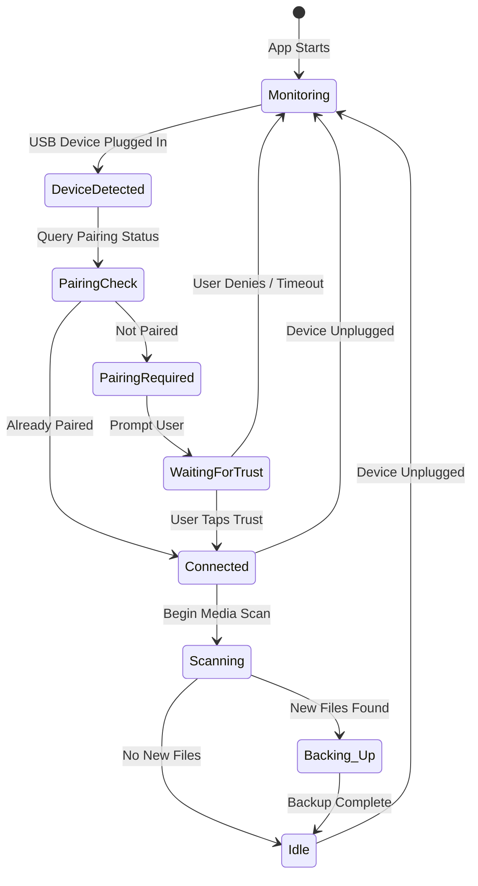
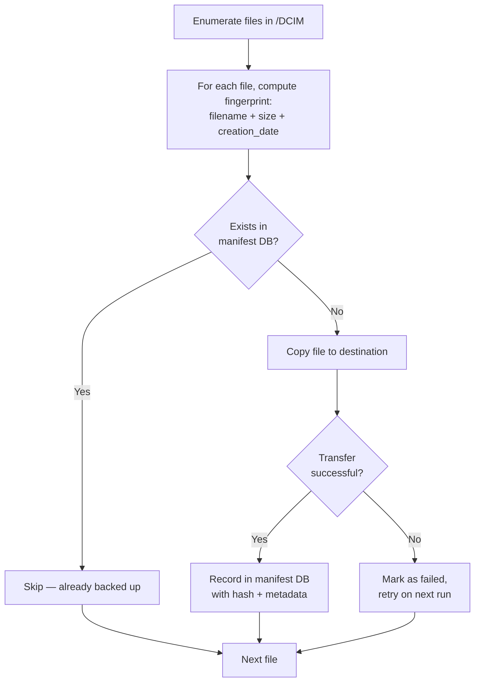
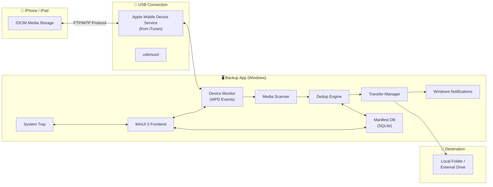

# 📋 Product Requirements Document (PRD)
## iOS Media Backup — Windows Native Desktop App

| Field | Value |
|---|---|
| **Version** | 1.0 (Draft) |
| **Date** | October 13, 2026 |
| **Status** | 🟡 Under Review |
| **Target Platform** | Windows 10/11 (x64) |

---

## 1. Problem Statement

iPhone users accumulate thousands of photos and videos over time, but keeping a reliable local backup on a Windows PC is frustratingly manual. Existing solutions are either:

- **iCloud** — requires a subscription, relies on internet bandwidth, and doesn't give you a simple folder of files on your PC.
- **iTunes / Apple Devices** — creates opaque encrypted backup blobs, not browsable media files.
- **Manual drag-and-drop via File Explorer** — works, but requires the user to remember which files were already copied, has no deduplication, and is tedious for large libraries.

**There is no lightweight, dedicated Windows app that automatically performs incremental media backups from an iOS device over USB to a user-chosen local folder.**

---

## 2. Product Vision

> A single-purpose, native Windows desktop app that **automatically backs up all photos and videos** from a connected iPhone/iPad to a local destination folder — **incrementally, reliably, and without duplicates** — every time the device is plugged in via USB.

### Design Principles
1. **Zero-friction** — plug in the cable, backup starts automatically
2. **Incremental by default** — never re-copy what's already backed up
3. **Transparent storage** — files land as normal JPG/HEIC/MOV/MP4 in browsable folders
4. **Privacy-first** — no cloud, no accounts, no telemetry; everything stays local
5. **Lightweight** — small footprint, no bloat, fast startup

---

## 3. Target Users

| Persona | Description |
|---|---|
| **Casual iPhone User** | Non-technical user who wants a simple "plug and forget" backup for family photos/videos |
| **Photography Enthusiast** | User with 50K+ photos who needs reliable, organized local archiving |
| **Privacy-Conscious User** | Someone who avoids cloud services and wants full local control |
| **IT Support / Family Tech Lead** | Person who manages backups for multiple family members' devices |

---

## 4. Core Features (MVP)

### 4.1 Device Detection & Connection

| Req ID | Requirement | Priority |
|---|---|---|
| F-01 | Auto-detect iOS devices when connected via USB cable | P0 |
| F-02 | Display device name, model, iOS version, and storage info | P0 |
| F-03 | Handle the "Trust This Computer" pairing workflow gracefully with user guidance | P0 |
| F-04 | Support multiple iOS devices (remembered separately) | P1 |
| F-05 | Show connection status indicator (connected / disconnected / pairing required) | P0 |

#### Device Connection Flow


---

### 4.2 Destination Selection & Management

| Req ID | Requirement | Priority |
|---|---|---|
| F-06 | Allow user to choose any local folder (or external drive) as the backup destination | P0 |
| F-07 | Remember destination per device (different iPhones can back up to different folders) | P1 |
| F-08 | Validate destination has sufficient free space before starting backup | P0 |
| F-09 | Warn if destination drive is disconnected or path is invalid | P0 |
| F-10 | Support configurable subfolder organization (see §4.4) | P1 |

---

### 4.3 Incremental Backup Engine

> [!IMPORTANT]
> This is the core value proposition of the product — reliable, deduplicated, incremental backup.

| Req ID | Requirement | Priority |
|---|---|---|
| F-11 | Scan all media from iOS `/DCIM` directory tree | P0 |
| F-12 | Maintain a local manifest database of previously backed-up files | P0 |
| F-13 | Identify new/changed files by comparing **filename + file size + creation date** (fast check) | P0 |
| F-14 | Optional: verify integrity via SHA-256 hash for critical dedup scenarios | P2 |
| F-15 | Skip files already present in destination (no duplicates) | P0 |
| F-16 | Resume interrupted backups (track per-file transfer completion) | P1 |
| F-17 | Support backing up HEIF/HEIC photos, Live Photos (MOV pairs), and ProRes/4K video | P0 |
| F-18 | Handle RAW photo formats (DNG from iPhone ProRAW) | P1 |

#### Deduplication Strategy



#### Manifest Database Schema (SQLite)

```
TABLE backed_up_files (
    id              INTEGER PRIMARY KEY AUTOINCREMENT,
    device_udid     TEXT NOT NULL,
    source_path     TEXT NOT NULL,          -- e.g. /DCIM/100APPLE/IMG_0001.HEIC
    dest_path       TEXT NOT NULL,          -- e.g. D:\Backup\iPhone\2026\10\IMG_0001.HEIC
    file_name       TEXT NOT NULL,
    file_size       INTEGER NOT NULL,
    creation_date   TEXT NOT NULL,          -- ISO 8601
    modification_date TEXT,
    sha256_hash     TEXT,                   -- optional, computed post-transfer
    media_type      TEXT NOT NULL,          -- photo | video | live_photo | raw
    backup_date     TEXT NOT NULL,          -- when the backup occurred
    status          TEXT DEFAULT 'complete' -- complete | failed | partial
);

INDEX idx_device_source ON backed_up_files(device_udid, source_path);
INDEX idx_fingerprint ON backed_up_files(device_udid, file_name, file_size, creation_date);
```

---

### 4.4 File Organization

| Req ID | Requirement | Priority |
|---|---|---|
| F-19 | Default organization: `<destination>/<DeviceName>/<YYYY>/<MM>/filename.ext` | P0 |
| F-20 | Alternative flat mode: `<destination>/<DeviceName>/filename.ext` | P2 |
| F-21 | Preserve original filenames from iOS | P0 |
| F-22 | Handle filename collisions (append `-1`, `-2`, etc.) | P0 |
| F-23 | Preserve EXIF metadata during copy (no re-encoding) | P0 |

---

### 4.5 Automation & Background Operation

| Req ID | Requirement | Priority |
|---|---|---|
| F-24 | Option to auto-start backup when device is connected (no manual trigger needed) | P0 |
| F-25 | Run minimized to system tray | P0 |
| F-26 | Optional: launch on Windows startup (user-configurable) | P1 |
| F-27 | Windows notification when backup starts, completes, or fails | P0 |
| F-28 | Prevent PC sleep during active backup transfer | P1 |

---

### 4.6 Progress & Reporting

| Req ID | Requirement | Priority |
|---|---|---|
| F-29 | Real-time progress bar showing files copied / total files / percentage | P0 |
| F-30 | Transfer speed indicator (MB/s) | P2 |
| F-31 | Estimated time remaining | P2 |
| F-32 | Post-backup summary: total files, total size, new files, skipped files, errors | P0 |
| F-33 | Backup history log viewable in-app | P1 |

---

## 5. Technical Architecture

### 5.1 Technology Stack (Recommended)

| Layer | Technology | Rationale |
|---|---|---|
| **Language** | C# (.NET 8+) | First-class Windows support, strong ecosystem, fast development |
| **UI Framework** | WinUI 3 (Windows App SDK) | Modern, native Windows look and feel, MSIX packaging |
| **iOS Communication — Primary** | `MediaDevices` NuGet package (WPD/PTP wrapper) | Simplest integration; iPhone exposes DCIM via PTP when iTunes drivers are installed |
| **iOS Communication — Fallback** | `imobiledevice-net` (libimobiledevice .NET wrapper) | Deeper device access, more reliable for some edge cases |
| **Local Database** | SQLite via `Microsoft.Data.Sqlite` | Lightweight, embedded, perfect for manifest tracking |
| **Installer** | MSIX or WiX-based MSI | Standard Windows distribution |
| **Background Service** | .NET `BackgroundService` + Windows Task Scheduler | For auto-start and tray operation |

### 5.2 System Architecture Diagram



### 5.3 Prerequisites & Dependencies

> [!NOTE]
> Since you already have iTunes installed, the critical **Apple Mobile Device Support** driver is already present on your system. This driver is what enables Windows to recognize the iPhone as a PTP device and is required for both the `MediaDevices` and `libimobiledevice` approaches.

| Dependency | Required? | Notes |
|---|---|---|
| **iTunes or Apple Devices app** | Yes (user must have installed) | Provides Apple Mobile Device Service + USB drivers |
| **.NET 8 Runtime** | Bundled with app | Self-contained deployment eliminates this dependency |
| **Windows 10 1809+** | Yes | Required for WinUI 3 / Windows App SDK |

### 5.4 Two-Tier Device Communication Strategy

We recommend a **dual-approach** to maximize reliability:

| Tier | Method | When Used |
|---|---|---|
| **Primary** | WPD / PTP via `MediaDevices` NuGet | Default path. iPhone appears as a PTP imaging device. Simple, well-supported, uses Windows native stack. |
| **Fallback** | `libimobiledevice` via `imobiledevice-net` | If WPD fails, is too slow, or if we need richer metadata (e.g., exact creation timestamps beyond EXIF). Uses Apple's native AFC protocol. |

**Why both?**
- WPD/PTP is simpler but has known quirks (device can drop out when screen locks, limited metadata).
- libimobiledevice is more robust but requires managing native DLLs and is more complex to integrate.
- Starting with WPD and falling back to libimobiledevice gives us the best of both worlds.

---

## 6. User Interface (MVP)

### 6.1 Main Window

```
┌─────────────────────────────────────────────────────────┐
│  📱 iBackup                                    ─  □  ✕  │
├─────────────────────────────────────────────────────────┤
│                                                         │
│  ┌─────────────────────────────────────────────────┐    │
│  │  📱 Ismail's iPhone 16 Pro         ● Connected  │    │
│  │  iOS 19.0 · 128 GB · 47.2 GB Used               │    │
│  └─────────────────────────────────────────────────┘    │
│                                                         │
│  Backup Destination                                     │
│  ┌─────────────────────────────────────┐ ┌──────────┐  │
│  │ D:\Photos\iPhone Backup             │ │ Browse…  │  │
│  └─────────────────────────────────────┘ └──────────┘  │
│                                                         │
│  ┌─────────────────────────────────────────────────┐    │
│  │  Status: Scanning for new files…                 │    │
│  │  ████████████░░░░░░░░░░  2,847 / 5,123 files    │    │
│  │  12.4 GB copied · 8.7 GB remaining · ~6 min     │    │
│  └─────────────────────────────────────────────────┘    │
│                                                         │
│  ┌───────────────┐  ┌────────────────┐                  │
│  │ ▶ Start Backup │  │ ⏸ Pause        │                  │
│  └───────────────┘  └────────────────┘                  │
│                                                         │
│  Last backup: Oct 12, 2026 at 9:45 PM · 342 new files  │
│                                                         │
│  ─────────────────────────────────────────────────────  │
│  ☑ Auto-backup when device connects                     │
│  ☑ Minimize to system tray                              │
│  ☐ Start with Windows                                   │
│                                                         │
│  ⚙ Settings    📊 History    ❓ Help                     │
└─────────────────────────────────────────────────────────┘
```

### 6.2 System Tray Behavior

- App minimizes to system tray (notification area)
- Tray icon shows status: idle (gray), backing up (blue animated), error (red)
- Right-click menu: Open, Start Backup, Pause, Settings, Quit
- Balloon notifications for: backup started, backup complete, errors

### 6.3 Settings Panel

| Setting | Type | Default |
|---|---|---|
| Auto-backup on connect | Toggle | ON |
| Start with Windows | Toggle | OFF |
| Minimize to tray on close | Toggle | ON |
| Folder organization | Dropdown | By Year/Month |
| File types to include | Multi-select checkboxes | All (Photos + Videos) |
| Keep device screen awake during backup | Toggle | OFF (informational note only) |
| Verify integrity after copy (SHA-256) | Toggle | OFF |

---

## 7. Supported Media Types

| Category | File Extensions | Notes |
|---|---|---|
| **Photos** | `.jpg`, `.jpeg`, `.heic`, `.heif`, `.png`, `.tiff`, `.bmp`, `.gif`, `.webp` | HEIC is default iPhone format since iOS 11 |
| **Videos** | `.mov`, `.mp4`, `.m4v` | MOV is native iPhone video container |
| **Live Photos** | `.heic` + paired `.mov` | Must be backed up as a pair to preserve the Live Photo |
| **ProRAW** | `.dng` | Apple ProRAW format (iPhone 12 Pro+) |
| **ProRes Video** | `.mov` (ProRes codec) | Large files, may be multi-GB |
| **Screenshots** | `.png` | Stored in same DCIM structure |
| **Slow-Mo / Time-Lapse** | `.mov` | Standard video container |

---

## 8. Edge Cases & Error Handling

| Scenario | Expected Behavior |
|---|---|
| Device disconnected mid-transfer | Pause gracefully, mark file as `partial`, resume on reconnect |
| Destination disk full | Pause backup, notify user, suggest alternative destination |
| Destination path deleted/unavailable | Prompt user to select new destination before next backup |
| Filename collision | Append sequential number: `IMG_001.HEIC` → `IMG_001-1.HEIC` |
| Corrupt file on device | Log error, skip file, continue with remaining files |
| Screen locks during backup | Backup continues (PTP may disconnect — fallback to AFC or warn user) |
| Device requires iOS update prompt | Handle gracefully; don't crash |
| Very large library (100K+ files) | Manifest DB indexed queries; paginated scanning; no memory bloat |
| Multiple devices connected simultaneously | Queue or parallel backup (P2 — MVP handles one at a time) |
| HEIC files user wants as JPG | Future feature: optional HEIC→JPG conversion (post-MVP) |

---

## 9. Security & Privacy

| Concern | Mitigation |
|---|---|
| No cloud / no internet | App operates fully offline; no network calls whatsoever |
| No telemetry / analytics | Zero data collection |
| Manifest DB contains file paths | DB stored locally; no encryption needed for MVP (optional P2) |
| USB pairing trust | Follows Apple's standard "Trust This Computer" security model |
| Sensitive media content | Files are copied as-is; app never reads/parses image content |

---

## 10. Performance Requirements

| Metric | Target |
|---|---|
| Scan time (10,000 files) | < 30 seconds |
| Transfer speed | ≥ 25 MB/s sustained (USB 2.0 iPhone typical) |
| App startup time | < 2 seconds |
| Memory usage (idle) | < 50 MB |
| Memory usage (active backup) | < 200 MB |
| Manifest DB query time | < 100ms for dedup lookup |

---

## 11. Milestones & MVP Scope

### Phase 1 — MVP (Target: 6-8 weeks)

| Week | Deliverable |
|---|---|
| 1–2 | Project scaffolding, WinUI 3 shell, device detection via WPD |
| 3–4 | DCIM scanning, manifest DB, incremental backup engine |
| 5–6 | File transfer with progress, dedup logic, error handling |
| 7 | System tray, auto-backup, Windows notifications |
| 8 | Testing, polish, installer packaging |

### Phase 2 — Post-MVP Enhancements

| Feature | Priority |
|---|---|
| HEIC → JPG auto-conversion option | P2 |
| Backup scheduling (daily at specific time if connected) | P2 |
| Thumbnail preview of backed-up media | P2 |
| Selective backup (choose specific albums/date ranges) | P2 |
| Backup verification / integrity check scan | P2 |
| Multiple simultaneous device support | P2 |
| Backup to NAS / network share | P2 |
| Dark mode / theme support | P3 |
| Portable/standalone version (no install) | P3 |
| Export backup report as CSV/PDF | P3 |

---

## 12. Competitive Landscape

| Product | Pros | Cons |
|---|---|---|
| **iMazing** | Feature-rich, reliable | Paid (\$50+), bloated, does much more than backup |
| **CopyTrans Photo** | Good UX | Paid, limited free tier |
| **iTunes Backup** | Free, official | Opaque blob format, not browsable files |
| **Windows File Explorer** | Free, built-in | No incremental tracking, manual, tedious |
| **iCloud** | Automatic, seamless | Requires subscription for > 5GB, needs internet |
| **Our App** | **Free, focused, incremental, transparent files** | New product, single developer |

---

## 13. Success Metrics

| Metric | Target (6 months post-launch) |
|---|---|
| Successful backup completion rate | > 99% |
| Average backup time (incremental, <100 new files) | < 2 minutes |
| App crash rate | < 0.1% of sessions |
| User-reported duplicate files | 0 |

---

## 14. Open Questions & Decisions Needed

> [!WARNING]
> The following decisions should be resolved before development begins.

| # | Question | Options | Recommendation |
|---|---|---|---|
| 1 | **App name?** | iBackup, PhotoSync, SnapVault, MediaPull, CableBackup | Need your input |
| 2 | **Primary communication method?** | WPD/PTP only, libimobiledevice only, or dual-tier (both) | Dual-tier (start WPD, fall back to libimobiledevice) |
| 3 | **Free or freemium model?** | Fully free, free + donation, freemium with pro features | Need your input |
| 4 | **HEIC handling in MVP?** | Copy as-is (preserve HEIC), or auto-convert to JPG | Copy as-is for MVP; conversion as P2 |
| 5 | **Should the app request iPhone to "stay awake"?** | Yes (keeps screen on), No (just warn user) | Warn user; can't reliably control iPhone from Windows |
| 6 | **Installer type?** | MSIX (modern, Microsoft Store ready), MSI (traditional), or both | MSIX for simplicity; MSI if Store is not desired |
| 7 | **Minimum iOS version supported?** | iOS 14+, iOS 15+, iOS 16+ | iOS 15+ (covers >95% of active devices) |
| 8 | **Should Live Photos be kept as paired files or merged?** | Paired (`.heic` + `.mov` side by side), or single container | Paired — simpler, preserves originals |

---

## 15. Glossary

| Term | Definition |
|---|---|
| **AFC** | Apple File Conduit — Apple's protocol for file access on iOS devices over USB |
| **AMDS** | Apple Mobile Device Service — Windows service installed by iTunes that handles iOS USB communication |
| **DCIM** | Digital Camera Images — the standard directory where iOS stores photos and videos |
| **HEIC/HEIF** | High Efficiency Image Format — Apple's default photo format since iOS 11 |
| **PTP** | Picture Transfer Protocol — standard protocol for transferring images from cameras/phones |
| **WPD** | Windows Portable Devices — Windows API for communicating with portable devices |
| **UDID** | Unique Device Identifier — Apple's per-device identifier |
| **Manifest DB** | Local SQLite database tracking which files have been backed up |
| **usbmuxd** | USB Multiplexing Daemon — handles USB-over-TCP communication with iOS devices |

---

*Document authored: October 13, 2026 · Ready for stakeholder review*
