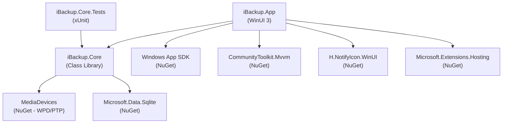
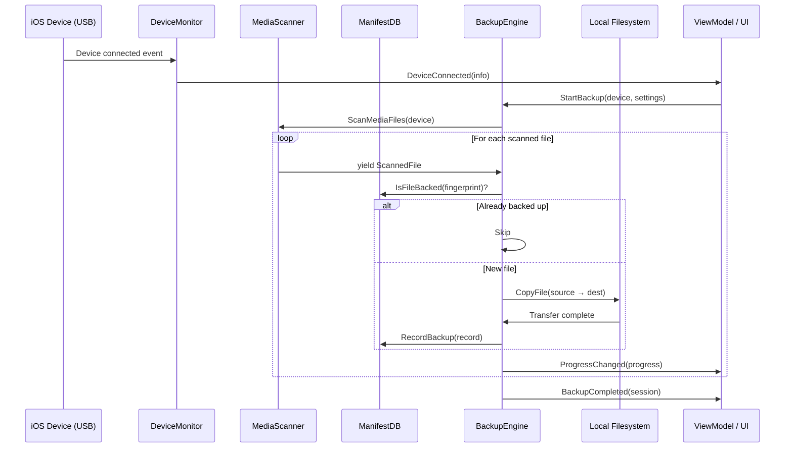

# 🏗️ Technical Design Document
## iBackup — iOS Media Backup for Windows

| Field | Value |
|---|---|
| **Version** | 1.0 |
| **Date** | October 13, 2026 |
| **Based on** | [PRD v1.0](./PRD.md) |

---

## 1. Architecture Overview

### 1.1 Solution Structure

```
iBackup/
├── iBackup.sln
├── src/
│   ├── iBackup.Core/              # Business logic, device I/O, data layer
│   │   ├── Models/                # Domain entities
│   │   ├── Interfaces/            # Service contracts
│   │   ├── Services/              # Implementations
│   │   └── Data/                  # SQLite manifest DB
│   ├── iBackup.App/               # WinUI 3 desktop application
│   │   ├── Views/                 # XAML pages
│   │   ├── ViewModels/            # MVVM view models
│   │   ├── Converters/            # XAML value converters
│   │   ├── Helpers/               # Utility classes
│   │   └── Assets/                # Icons, images
│   └── iBackup.Core.Tests/        # Unit tests
└── docs/
```

### 1.2 Dependency Graph



### 1.3 Design Decisions

| Decision | Choice | Rationale |
|---|---|---|
| **Pattern** | MVVM | Standard for WinUI 3; clean separation of UI and logic |
| **DI Container** | `Microsoft.Extensions.DependencyInjection` | Industry standard, integrates with `IHost` for background services |
| **MVVM Toolkit** | `CommunityToolkit.Mvvm` | Source generators reduce boilerplate; `ObservableProperty`, `RelayCommand` |
| **Database** | Raw `Microsoft.Data.Sqlite` | Simpler and lighter than EF Core for a single-table manifest |
| **Device Access (Primary)** | `MediaDevices` NuGet | Clean .NET wrapper over WPD; iPhone DCIM accessible via PTP |
| **Device Access (Fallback)** | `imobiledevice-net` | AFC protocol; more robust when PTP drops |
| **System Tray** | `H.NotifyIcon.WinUI` | Mature library; supports WinUI 3 natively |
| **Notifications** | `Microsoft.Windows.AppNotifications` | Part of Windows App SDK; native toast notifications |
| **Logging** | `Microsoft.Extensions.Logging` + Serilog | Structured logging to file for debugging |

---

## 2. Module Design

### 2.1 Core Models

```csharp
// Key domain entities
DeviceInfo          // UDID, name, model, iOS version, storage capacity
BackupFileRecord    // Source path, dest path, fingerprint, status, timestamps  
BackupSession       // Session ID, device, start/end time, stats
BackupSettings      // Destination, auto-backup, org mode, file type filters
BackupProgress      // Current file, files done/total, bytes done/total, speed
MediaType           // Enum: Photo, Video, LivePhoto, Raw, Screenshot
FileOrganizationMode // Enum: ByYearMonth, ByYearMonthDay, Flat
BackupStatus        // Enum: Complete, Failed, Partial, Skipped
```

### 2.2 Service Interfaces

```csharp
IDeviceMonitor
├── event DeviceConnected(DeviceInfo)
├── event DeviceDisconnected(string udid)
├── StartMonitoring()
├── StopMonitoring()
└── GetConnectedDevices() → List<DeviceInfo>

IMediaScanner
├── ScanMediaFiles(DeviceInfo) → IAsyncEnumerable<ScannedFile>
└── GetMediaCount(DeviceInfo) → Task<int>

IBackupEngine
├── event ProgressChanged(BackupProgress)
├── event BackupCompleted(BackupSession)
├── event BackupFailed(Exception)
├── StartBackup(DeviceInfo, BackupSettings) → Task<BackupSession>
├── PauseBackup()
├── ResumeBackup()
└── CancelBackup()

IManifestRepository
├── IsFileBacked(string udid, string filename, long size, DateTime created) → bool
├── RecordBackup(BackupFileRecord) → Task
├── GetBackupHistory(string udid) → List<BackupSession>
├── GetStats(string udid) → BackupStats
└── Initialize() → Task  // Creates tables if not exist

IFileTransferService
├── CopyFile(string sourcePath, string destPath, CancellationToken) → Task<TransferResult>
└── event BytesTransferred(long bytes)
```

### 2.3 Data Flow



---

## 3. Database Schema

Single SQLite database stored at `%LOCALAPPDATA%\iBackup\manifest.db`.

```sql
CREATE TABLE IF NOT EXISTS backed_up_files (
    id              INTEGER PRIMARY KEY AUTOINCREMENT,
    device_udid     TEXT    NOT NULL,
    source_path     TEXT    NOT NULL,
    dest_path       TEXT    NOT NULL,
    file_name       TEXT    NOT NULL,
    file_size       INTEGER NOT NULL,
    creation_date   TEXT    NOT NULL,
    modification_date TEXT,
    sha256_hash     TEXT,
    media_type      TEXT    NOT NULL,
    backup_date     TEXT    NOT NULL,
    status          TEXT    NOT NULL DEFAULT 'complete',
    
    UNIQUE(device_udid, source_path)
);

CREATE INDEX IF NOT EXISTS idx_fingerprint 
    ON backed_up_files(device_udid, file_name, file_size, creation_date);

CREATE TABLE IF NOT EXISTS backup_sessions (
    id              INTEGER PRIMARY KEY AUTOINCREMENT,
    device_udid     TEXT    NOT NULL,
    device_name     TEXT    NOT NULL,
    started_at      TEXT    NOT NULL,
    completed_at    TEXT,
    total_files     INTEGER DEFAULT 0,
    new_files       INTEGER DEFAULT 0,
    skipped_files   INTEGER DEFAULT 0,
    failed_files    INTEGER DEFAULT 0,
    total_bytes     INTEGER DEFAULT 0,
    status          TEXT    NOT NULL DEFAULT 'in_progress'
);

CREATE TABLE IF NOT EXISTS device_settings (
    device_udid         TEXT PRIMARY KEY,
    device_name         TEXT NOT NULL,
    destination_path    TEXT,
    auto_backup         INTEGER DEFAULT 1,
    organization_mode   TEXT DEFAULT 'YearMonth',
    last_seen           TEXT
);
```

---

## 4. Error Handling Strategy

| Layer | Strategy |
|---|---|
| **USB disconnect** | `BackupEngine` catches I/O exceptions → marks current file as `partial` → fires `BackupPaused` event → auto-retries when device reconnects |
| **Disk full** | Pre-check free space before each file → if insufficient, pause and notify |
| **File I/O errors** | Catch per-file, log error, mark as `failed`, continue to next file |
| **WPD failures** | Catch `COMException` → fall back to `libimobiledevice` if available |
| **DB corruption** | WAL mode for crash safety; backup the `.db` file periodically |
| **Unexpected crashes** | Global exception handler logs to file; `partial` records cleaned up on next launch |

---

## 5. Threading Model

```
UI Thread (STA)
├── WinUI 3 rendering, XAML bindings
└── DispatcherQueue for thread marshaling

Background Thread Pool
├── DeviceMonitor polling (Timer-based, every 2s)
├── MediaScanner enumeration (async I/O)
└── File transfer operations (async streams)

BackupEngine orchestration
├── Runs on TaskScheduler.Default
├── Reports progress via IProgress<BackupProgress>
└── Respects CancellationToken for pause/cancel
```

---

## 6. Deployment

| Aspect | Approach |
|---|---|
| **Packaging** | Self-contained single-file publish (no .NET runtime needed on target) |
| **Installer** | MSIX for Microsoft Store; optional MSI via WiX for direct download |
| **Auto-update** | MSIX handles updates via Store; MSI via custom update check (post-MVP) |
| **Data location** | `%LOCALAPPDATA%\iBackup\` for DB, settings, logs |
| **Prerequisites** | iTunes or Apple Devices app (for USB drivers) |

---

## 7. Testing Strategy

| Type | Coverage Target | Tools |
|---|---|---|
| **Unit Tests** | ManifestRepository, BackupEngine logic, dedup algorithm | xUnit + Moq |
| **Integration Tests** | SQLite operations, file organization logic | xUnit + in-memory SQLite |
| **Manual Testing** | USB device connection, full backup flow | Physical iPhone + Windows PC |

---

*This document is the engineering blueprint. Refer to [PRD.md](./PRD.md) for product requirements.*
